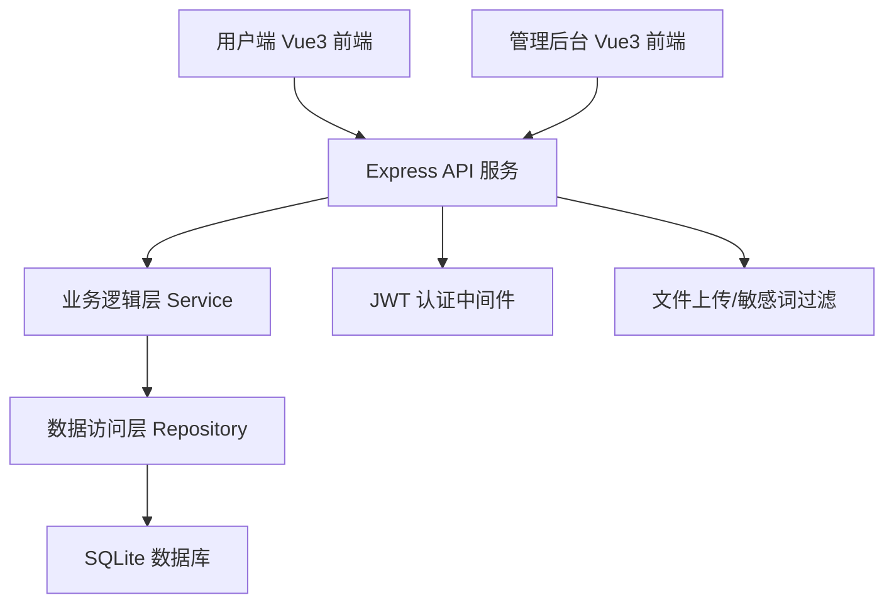
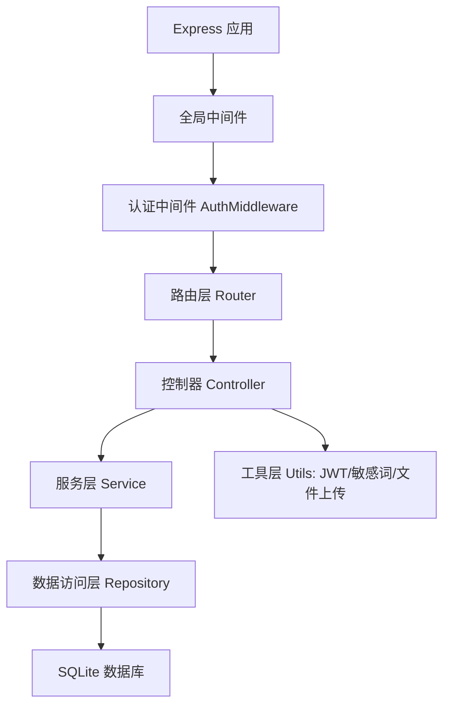
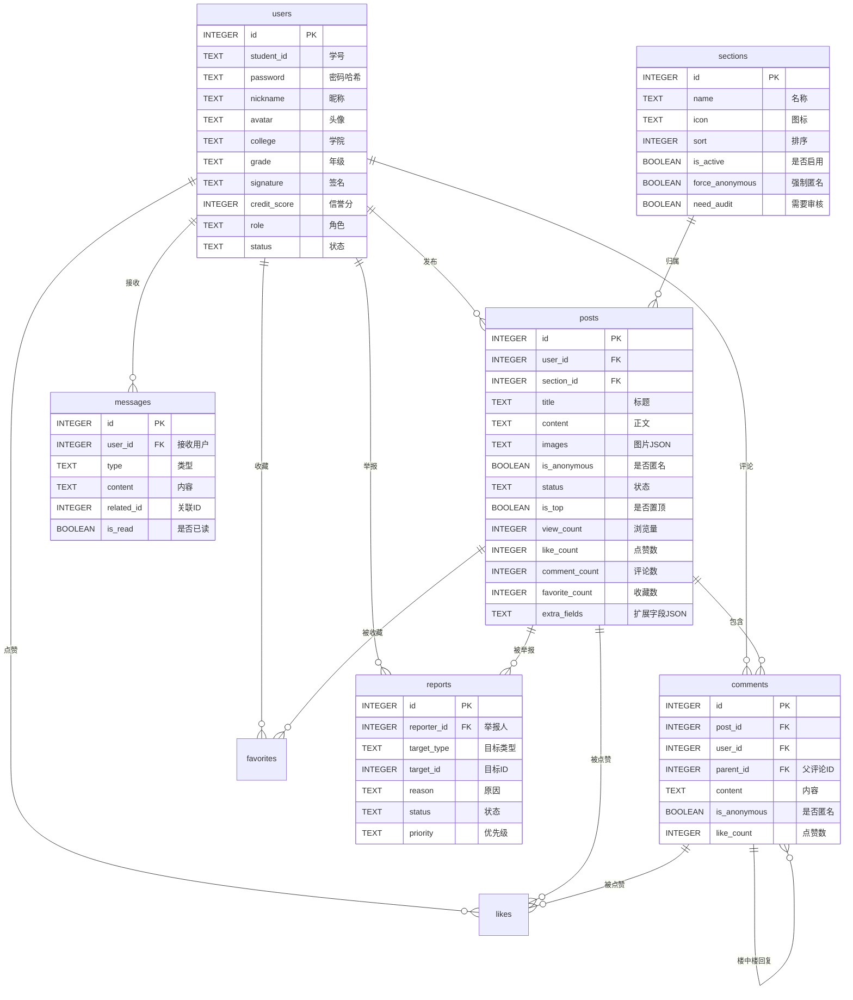

## 1. 架构设计

项目采用前后端分离架构，前端使用 Vue 3 + TypeScript，后端使用 Express.js + TypeScript，数据存储使用 SQLite（轻量便于演示，可替换为 MySQL/PostgreSQL）。



- **用户端前端**：面向普通学生用户，提供浏览、发帖、互动等功能
- **管理后台前端**：独立路由工程，面向管理员，提供审核、用户管理、数据看板
- **后端 API**：统一提供 RESTful 接口，区分用户端与管理端路由
- **数据库**：SQLite 文件数据库，便于项目开箱即用

## 2. 技术选型

- **前端**：Vue@3 + TypeScript + Vite + Tailwind CSS + Vue Router + Pinia
- **初始化工具**：vite-init（vue-express-ts 模板）
- **后端**：Express@4 + TypeScript
- **数据库**：SQLite（better-sqlite3）
- **认证**：JWT（jsonwebtoken）
- **密码加密**：bcryptjs
- **图表**：Chart.js（管理后台数据看板）
- **HTTP 客户端**：axios

## 3. 路由定义

### 3.1 用户端前端路由

| 路由 | 用途 | 是否需登录 |
|------|------|-----------|
| /login | 登录页 | 否 |
| /register | 注册页 | 否 |
| / | 首页信息流 | 否（游客可浏览） |
| /search | 搜索页 | 否 |
| /post/:id | 帖子详情页 | 否 |
| /publish | 发布页 | 是 |
| /message | 消息通知页 | 是 |
| /profile | 个人中心 | 是 |
| /profile/posts | 我的帖子 | 是 |
| /profile/comments | 我的评论 | 是 |
| /profile/favorites | 我的收藏 | 是 |
| /profile/settings | 账号设置 | 是 |
| /403 | 无权限页 | 否 |

### 3.2 管理后台前端路由

| 路由 | 用途 |
|------|------|
| /admin/login | 管理员登录 |
| /admin | 数据看板 |
| /admin/users | 用户管理 |
| /admin/posts | 内容审核 |
| /admin/comments | 评论管理 |
| /admin/reports | 举报处理 |
| /admin/sections | 板块管理 |

## 4. API 定义

### 4.1 认证相关

| 方法 | 路径 | 说明 |
|------|------|------|
| POST | /api/auth/register | 学号注册 |
| POST | /api/auth/login | 学号密码登录 |
| POST | /api/auth/logout | 退出登录 |
| GET | /api/auth/me | 获取当前用户信息 |
| PUT | /api/auth/password | 修改密码 |

### 4.2 帖子相关

| 方法 | 路径 | 说明 |
|------|------|------|
| GET | /api/posts | 帖子列表（支持板块、分页、关键词） |
| GET | /api/posts/:id | 帖子详情 |
| POST | /api/posts | 发布帖子 |
| PUT | /api/posts/:id | 编辑帖子 |
| DELETE | /api/posts/:id | 删除帖子 |
| POST | /api/posts/:id/like | 点赞/取消点赞 |
| POST | /api/posts/:id/favorite | 收藏/取消收藏 |
| POST | /api/posts/:id/report | 举报帖子 |

### 4.3 评论相关

| 方法 | 路径 | 说明 |
|------|------|------|
| GET | /api/posts/:id/comments | 评论列表 |
| POST | /api/posts/:id/comments | 发布评论 |
| POST | /api/comments/:id/reply | 楼中楼回复 |
| DELETE | /api/comments/:id | 删除评论 |
| POST | /api/comments/:id/like | 点赞评论 |

### 4.4 用户相关

| 方法 | 路径 | 说明 |
|------|------|------|
| GET | /api/users/:id | 用户公开信息 |
| PUT | /api/users/profile | 更新个人资料 |
| GET | /api/users/me/posts | 我的帖子 |
| GET | /api/users/me/comments | 我的评论 |
| GET | /api/users/me/favorites | 我的收藏 |

### 4.5 消息相关

| 方法 | 路径 | 说明 |
|------|------|------|
| GET | /api/messages | 消息列表 |
| PUT | /api/messages/read | 标记已读 |
| PUT | /api/messages/read-all | 全部已读 |

### 4.6 板块与搜索

| 方法 | 路径 | 说明 |
|------|------|------|
| GET | /api/sections | 板块列表 |
| GET | /api/search | 搜索帖子 |
| GET | /api/search/hot | 热门搜索词 |

### 4.7 管理后台

| 方法 | 路径 | 说明 |
|------|------|------|
| GET | /api/admin/users | 用户列表 |
| PUT | /api/admin/users/:id/ban | 封禁/解封用户 |
| PUT | /api/admin/users/:id/credit | 调整信誉分 |
| GET | /api/admin/posts | 帖子审核列表 |
| PUT | /api/admin/posts/:id/audit | 审核帖子（通过/驳回） |
| PUT | /api/admin/posts/:id/top | 设置置顶 |
| GET | /api/admin/comments | 评论管理列表 |
| DELETE | /api/admin/comments/:id | 删除违规评论 |
| GET | /api/admin/reports | 举报工单列表 |
| PUT | /api/admin/reports/:id | 处理举报 |
| GET | /api/admin/stats | 数据统计 |
| POST | /api/admin/sections | 新增板块 |
| PUT | /api/admin/sections/:id | 编辑板块 |
| DELETE | /api/admin/sections/:id | 删除板块 |

## 5. 服务端架构



## 6. 数据模型

### 6.1 数据模型定义



### 6.2 数据定义语言

```sql
-- 用户表
CREATE TABLE IF NOT EXISTS users (
  id INTEGER PRIMARY KEY AUTOINCREMENT,
  student_id TEXT UNIQUE NOT NULL,
  password TEXT NOT NULL,
  nickname TEXT NOT NULL,
  avatar TEXT DEFAULT '',
  college TEXT DEFAULT '',
  grade TEXT DEFAULT '',
  signature TEXT DEFAULT '',
  credit_score INTEGER DEFAULT 100,
  role TEXT DEFAULT 'user',
  status TEXT DEFAULT 'active',
  created_at DATETIME DEFAULT CURRENT_TIMESTAMP
);

-- 板块表
CREATE TABLE IF NOT EXISTS sections (
  id INTEGER PRIMARY KEY AUTOINCREMENT,
  name TEXT NOT NULL,
  icon TEXT DEFAULT '',
  sort INTEGER DEFAULT 0,
  is_active INTEGER DEFAULT 1,
  force_anonymous INTEGER DEFAULT 0,
  need_audit INTEGER DEFAULT 1,
  created_at DATETIME DEFAULT CURRENT_TIMESTAMP
);

-- 帖子表
CREATE TABLE IF NOT EXISTS posts (
  id INTEGER PRIMARY KEY AUTOINCREMENT,
  user_id INTEGER NOT NULL,
  section_id INTEGER NOT NULL,
  title TEXT NOT NULL,
  content TEXT NOT NULL,
  images TEXT DEFAULT '[]',
  is_anonymous INTEGER DEFAULT 0,
  status TEXT DEFAULT 'pending',
  is_top INTEGER DEFAULT 0,
  top_type TEXT DEFAULT 'none',
  view_count INTEGER DEFAULT 0,
  like_count INTEGER DEFAULT 0,
  comment_count INTEGER DEFAULT 0,
  favorite_count INTEGER DEFAULT 0,
  extra_fields TEXT DEFAULT '{}',
  created_at DATETIME DEFAULT CURRENT_TIMESTAMP,
  updated_at DATETIME DEFAULT CURRENT_TIMESTAMP,
  FOREIGN KEY (user_id) REFERENCES users(id),
  FOREIGN KEY (section_id) REFERENCES sections(id)
);

-- 评论表
CREATE TABLE IF NOT EXISTS comments (
  id INTEGER PRIMARY KEY AUTOINCREMENT,
  post_id INTEGER NOT NULL,
  user_id INTEGER NOT NULL,
  parent_id INTEGER DEFAULT NULL,
  content TEXT NOT NULL,
  is_anonymous INTEGER DEFAULT 0,
  like_count INTEGER DEFAULT 0,
  created_at DATETIME DEFAULT CURRENT_TIMESTAMP,
  FOREIGN KEY (post_id) REFERENCES posts(id),
  FOREIGN KEY (user_id) REFERENCES users(id),
  FOREIGN KEY (parent_id) REFERENCES comments(id)
);

-- 点赞表
CREATE TABLE IF NOT EXISTS likes (
  id INTEGER PRIMARY KEY AUTOINCREMENT,
  user_id INTEGER NOT NULL,
  target_type TEXT NOT NULL,
  target_id INTEGER NOT NULL,
  created_at DATETIME DEFAULT CURRENT_TIMESTAMP,
  UNIQUE(user_id, target_type, target_id)
);

-- 收藏表
CREATE TABLE IF NOT EXISTS favorites (
  id INTEGER PRIMARY KEY AUTOINCREMENT,
  user_id INTEGER NOT NULL,
  post_id INTEGER NOT NULL,
  created_at DATETIME DEFAULT CURRENT_TIMESTAMP,
  UNIQUE(user_id, post_id)
);

-- 消息表
CREATE TABLE IF NOT EXISTS messages (
  id INTEGER PRIMARY KEY AUTOINCREMENT,
  user_id INTEGER NOT NULL,
  type TEXT NOT NULL,
  content TEXT NOT NULL,
  related_id INTEGER DEFAULT NULL,
  is_read INTEGER DEFAULT 0,
  created_at DATETIME DEFAULT CURRENT_TIMESTAMP,
  FOREIGN KEY (user_id) REFERENCES users(id)
);

-- 举报表
CREATE TABLE IF NOT EXISTS reports (
  id INTEGER PRIMARY KEY AUTOINCREMENT,
  reporter_id INTEGER NOT NULL,
  target_type TEXT NOT NULL,
  target_id INTEGER NOT NULL,
  reason TEXT NOT NULL,
  status TEXT DEFAULT 'pending',
  priority TEXT DEFAULT 'normal',
  created_at DATETIME DEFAULT CURRENT_TIMESTAMP,
  FOREIGN KEY (reporter_id) REFERENCES users(id)
);

-- 草稿表
CREATE TABLE IF NOT EXISTS drafts (
  id INTEGER PRIMARY KEY AUTOINCREMENT,
  user_id INTEGER NOT NULL,
  section_id INTEGER DEFAULT NULL,
  title TEXT DEFAULT '',
  content TEXT DEFAULT '',
  images TEXT DEFAULT '[]',
  is_anonymous INTEGER DEFAULT 0,
  extra_fields TEXT DEFAULT '{}',
  created_at DATETIME DEFAULT CURRENT_TIMESTAMP,
  FOREIGN KEY (user_id) REFERENCES users(id)
);

-- 初始板块数据
INSERT INTO sections (name, icon, sort, is_active, force_anonymous, need_audit) VALUES
('二手交易', 'shopping-bag', 1, 1, 0, 1),
('失物招领', 'search', 2, 1, 0, 0),
('表白墙', 'heart', 3, 1, 0, 0),
('吐槽树洞', 'message-circle', 4, 1, 1, 0),
('互助问答', 'help-circle', 5, 1, 0, 0),
('校园活动', 'calendar', 6, 1, 0, 0);

-- 初始管理员账号（密码: admin123，bcrypt哈希）
INSERT INTO users (student_id, password, nickname, college, grade, role, status, credit_score) VALUES
('admin', '$2a$10$N9qo8uLOickgx2ZMRZoMyeIjZAgcfl7p92ldGxad68LJZdL17lhWy', '超级管理员', '信息学院', '2024', 'super_admin', 'active', 120);
```
