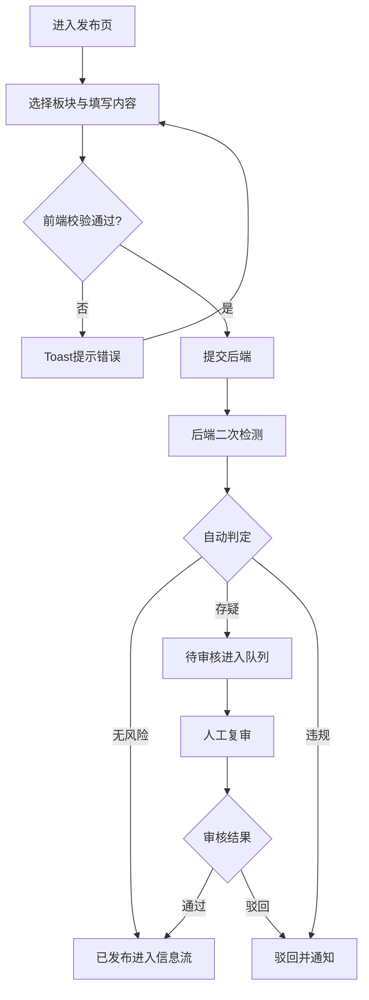

## 1. 产品概述

校园墙是一个面向本校学生的校园信息聚合社区平台，按场景分类提供二手交易、失物招领、表白墙、吐槽树洞、互助问答、校园活动等垂直板块，解决校园信息碎片化、传播效率低、匿名表达需求强等痛点。

- 目标用户：本校在校学生（含本科生、研究生）
- 核心价值：信息高效聚合、纯净校园生态、匿名合规表达、轻量化体验
- 运营目标：上线30天覆盖本校30%在校生，日活跃用户≥300人，日均发帖量≥80条

## 2. 核心功能

### 2.1 用户角色

| 角色 | 注册方式 | 核心权限 |
|------|----------|----------|
| 游客 | 无需注册 | 浏览公开帖子与评论，不可发布、互动、举报 |
| 普通用户 | 学号注册 | 浏览、发布、评论、点赞、收藏、举报、消息通知、个人中心 |
| 墙主（板块管理员） | 管理员分配 | 普通用户权限 + 本板块内容审核、置顶、举报处理 |
| 超级管理员 | 系统预设 | 全部权限 + 用户管理、板块管理、全局配置、数据看板 |

### 2.2 功能模块

1. **用户与账号体系**：注册登录、个人中心、信誉分体系
2. **内容发布与管理**：发帖、草稿箱、编辑删除、帖子详情
3. **内容浏览与搜索**：首页信息流、板块分类、搜索功能
4. **互动社交体系**：评论系统、点赞收藏
5. **消息通知系统**：消息分类、交互规则
6. **板块与内容运营**：板块管理、置顶与公告
7. **管理后台系统**：用户管理、内容审核、举报处理、数据看板
8. **内容安全与风控**：多层审核、匿名合规、防刷反作弊

### 2.3 页面清单

| 页面名称 | 模块名称 | 功能描述 |
|----------|----------|----------|
| 登录页 | 登录表单 | 学号+密码登录，记住密码，找回密码入口，跳转注册 |
| 注册页 | 注册表单 | 学号校验、密码设置、基础资料填写、协议同意 |
| 首页 | 顶部导航 | 搜索框、消息铃铛、头像入口 |
| 首页 | 板块Tab | 横向滑动切换板块，高亮下划线 |
| 首页 | 信息流 | 帖子列表，下拉刷新，上拉加载，骨架屏 |
| 首页 | 悬浮按钮 | 固定底部「+」发布入口 |
| 发布页 | 发布表单 | 板块选择、标题正文、图片上传、匿名切换、敏感词检测 |
| 发布页 | 草稿箱 | 最近10条草稿，恢复编辑、删除 |
| 帖子详情页 | 顶部导航 | 返回、板块名、更多操作（举报、分享） |
| 帖子详情页 | 内容展示 | 发布者信息、正文、九宫格图片、扩展字段 |
| 帖子详情页 | 互动栏 | 点赞、评论、收藏、举报按钮 |
| 帖子详情页 | 评论区 | 一级评论列表、楼中楼回复、热门评论置顶 |
| 搜索页 | 搜索框 | 输入关键词，300ms防抖搜索 |
| 搜索页 | 搜索历史 | 本地存储最近10条，单条删除、一键清空 |
| 搜索页 | 热门搜索 | 8个热门关键词 |
| 消息页 | 消息分类 | 评论、点赞、系统通知Tab |
| 消息页 | 消息列表 | 未读红点，全部已读，跳转详情 |
| 个人中心 | 资料页 | 头像、昵称、学号、学院、年级、签名、信誉分 |
| 个人中心 | 我的内容 | 我的帖子、我的评论、我的收藏 |
| 个人中心 | 账号设置 | 修改密码、退出登录、账号注销 |
| 后台-登录页 | 管理员登录 | 学号+密码，角色校验 |
| 后台-用户管理 | 用户列表 | 筛选、查看、封禁、重置密码、调整信誉分 |
| 后台-内容审核 | 帖子审核 | 待审核/已通过/已驳回/已删除Tab，批量操作 |
| 后台-内容审核 | 评论管理 | 全量评论列表，违规删除 |
| 后台-举报处理 | 举报工单 | 待处理/已处理Tab，工单详情，处理操作 |
| 后台-数据看板 | 指标卡片 | 日活、新增、发帖、评论、举报、通过率 |
| 后台-数据看板 | 趋势图表 | 折线图、饼图、柱状图 |
| 后台-板块管理 | 板块配置 | 新增、编辑、删除、排序、状态 |

## 3. 核心流程

### 3.1 帖子发布与审核流程

用户进入发布页 → 选择板块 → 填写标题、正文、上传图片 → 选择实名/匿名 → 前端实时校验（字段、字数、图片、敏感词） → 校验通过提交后端 → 后端二次敏感词+图片AI检测 → 自动判定（通过/待审核/驳回） → 人工复审（存疑内容） → 系统通知用户结果

### 3.2 账号登录与认证流程

用户进入登录页 → 输入学号+密码 → 前端格式校验 → 后端验证 → 成功生成Token存储 → 跳转首页；失败则提示（密码错误剩余次数/账号不存在/已封禁）。Token有效期7天，过期自动跳转登录页。

### 3.3 举报处理流程

用户点击举报 → 选择原因 → 提交工单 → 系统校验（24小时1次，3人举报升优先级） → 分配墙主/管理员 → 审核处理（驳回/删除/封禁） → 通知双方。高优先级2小时处理，普通24小时处理。

## 4. 用户界面设计

### 4.1 设计风格

- **主题色**：校园青春感，主色采用清新薄荷绿 `#10B981`（emerald-500）作为品牌色，传递活力与信任
- **辅助色**：暖橙 `#F59E0B` 用于点赞/热门标签，珊瑚红 `#EF4444` 用于举报/错误提示
- **中性色**：基于 zinc 灰阶体系，背景 `#FAFAFA`，卡片纯白带柔和阴影
- **按钮风格**：圆角胶囊形（rounded-full），主按钮实色填充，次按钮描边
- **字体**：标题使用思源黑体粗体，正文使用系统默认无衬线字体
- **布局**：移动端优先，卡片式布局，最大宽度960px居中
- **图标**：线性图标风格，统一描边粗细

### 4.2 页面设计概览

| 页面名称 | 模块名称 | UI元素 |
|----------|----------|--------|
| 首页 | 顶部导航 | 白色背景，搜索框圆角，铃铛带红点，头像圆形 |
| 首页 | 板块Tab | 横向滚动，选中下划线emerald色，未选中灰色 |
| 首页 | 信息流 | 白色卡片，圆角12px，阴影柔和，图片九宫格 |
| 首页 | 悬浮按钮 | 固定右下角，emerald圆形按钮，56px，带阴影 |
| 发布页 | 发布表单 | 板段下拉选择，正文textarea，图片九宫格预览 |
| 详情页 | 内容区 | 白底，图片九宫格可点击全屏预览 |
| 详情页 | 评论区 | 热门置顶带标签，楼中楼缩进展示 |
| 个人中心 | 资料卡 | 头像圆形大图，信誉分进度条彩色 |
| 后台 | 数据看板 | 卡片网格，图表使用emerald主色 |

### 4.3 响应式适配

- 移动端优先，基准宽度375px
- `<768px`：单列布局，底部导航
- `768px-1200px`：内容区最大宽度720px居中
- `>1200px`：内容区最大宽度960px居中，左右留白
- 兼容iOS 12+、Android 8+、微信内置浏览器

## 5. 信誉分体系

| 分值区间 | 功能权限 |
|----------|----------|
| 90-120分 | 全部功能正常，支持匿名发布 |
| 80-89分 | 正常发帖评论，不可匿名 |
| 60-79分 | 每日限发3条，不可匿名，不可发二手交易 |
| 0-59分 | 禁止发帖评论，仅可浏览 |

## 6. 板块差异化字段

| 板块 | 特有字段 |
|------|----------|
| 二手交易 | 价格、新旧程度、联系方式 |
| 失物招领 | 丢失/拾取地点、时间、物品类型 |
| 表白墙 | 表白对象（可选） |
| 吐槽树洞 | 无特有字段 |
| 互助问答 | 悬赏积分（可选） |
| 校园活动 | 活动时间、地点、主办方 |
