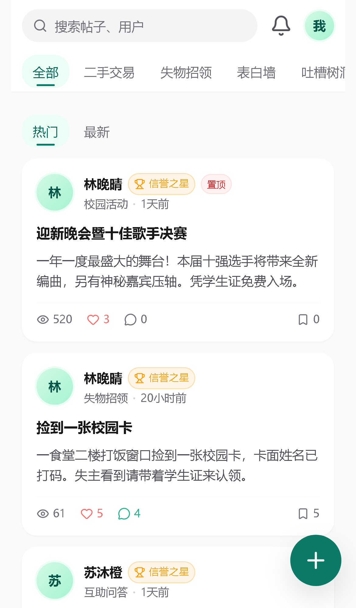
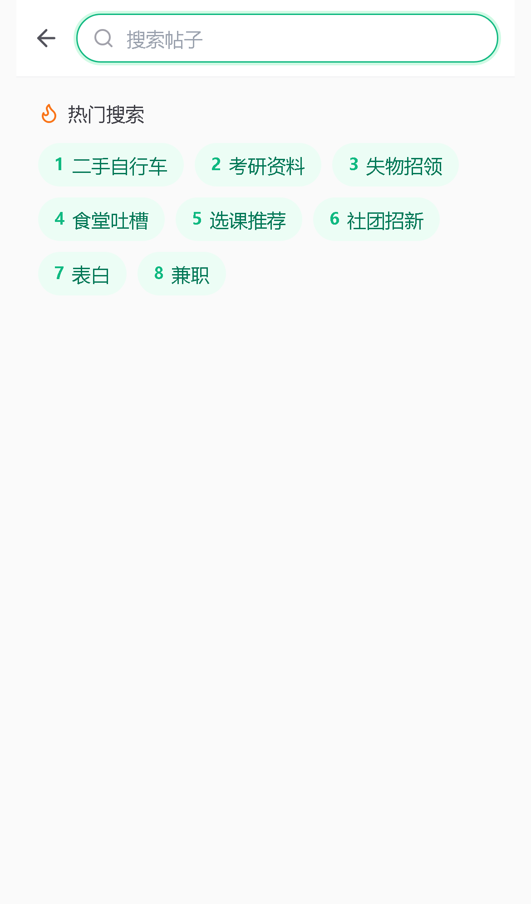
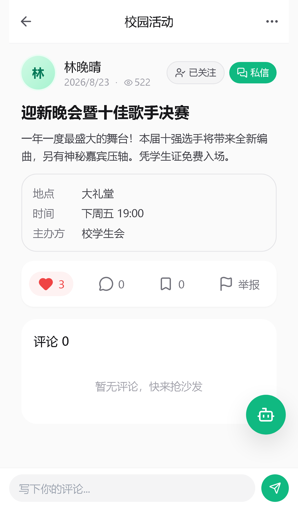
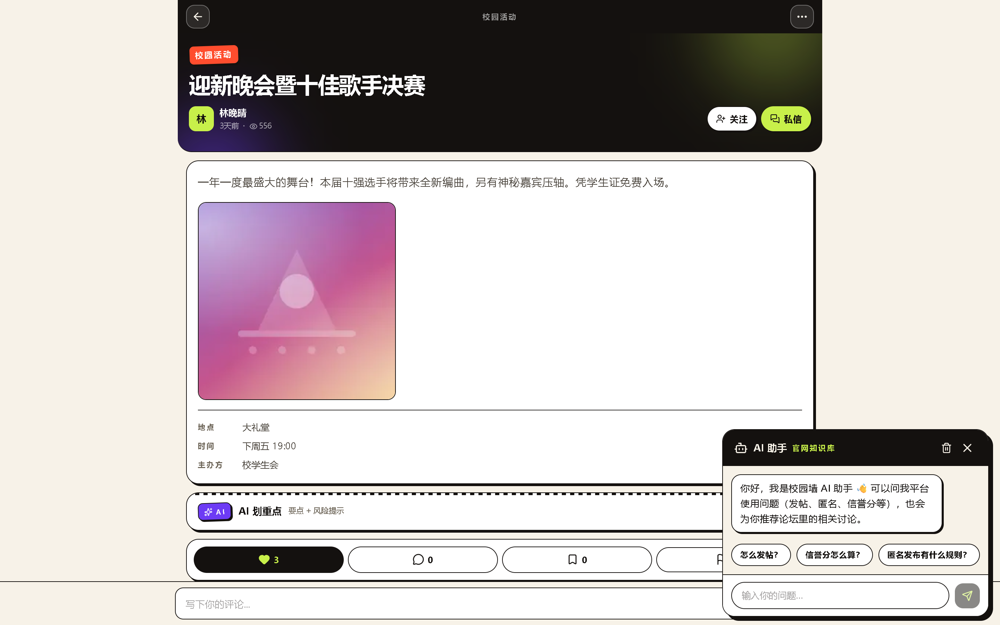
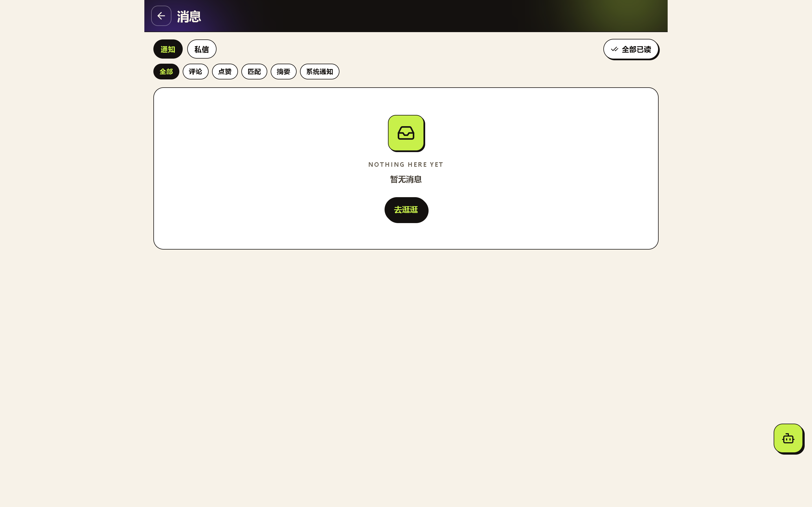
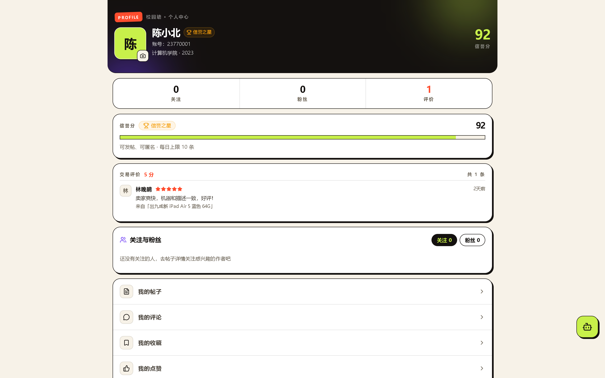
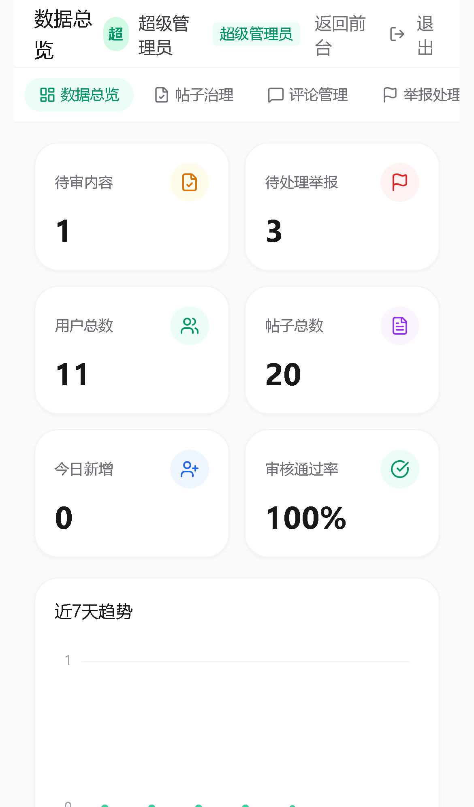
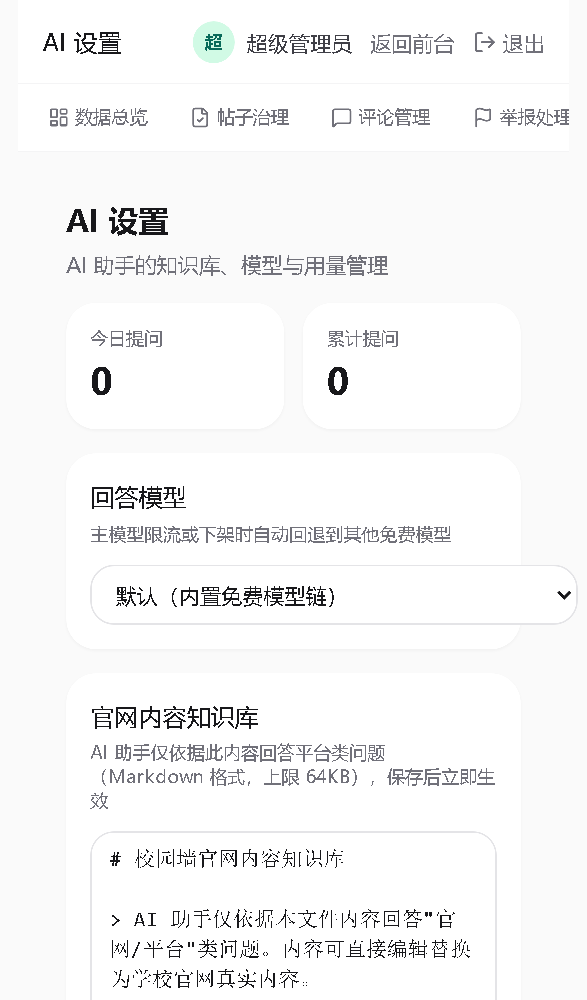

<p align="center">
  
</p>

# 校园墙 Campus Wall

> 面向本校学生的校园信息聚合社区平台，让校园生活更有温度。
> **V3 · AI 原生版**：紫粉多巴胺视觉（不再是绿白校园墙）+ AI 参与「发帖 → 读帖 → 看今天」主链路。

校园墙按场景分类提供**二手交易、失物招领、表白墙、吐槽树洞、互助问答、校园活动、拼车、组队**八大垂直板块，支持 **Web 网页端 + 微信小程序**双端访问，解决校园信息碎片化、传播效率低、匿名表达需求强等痛点。

- 信息高效聚合 · 纯净校园生态 · 匿名合规表达 · 轻量化体验

---

## ✨ 功能特性

### AI 原生能力

| 入口 | 能力 | 没有大模型时 |
|---|---|---|
| 发布页 · **AI 一键成稿**（Web + 小程序） | 一句话 → 标题 / 正文 / 板块 / 价格 / 话题标签 | 板块套版：抽取原文实有的物品/成色/价格/时间/地点/联系方式成 📌 结构化清单，情绪板块不套版，同样能出规范稿 |
| 详情页 · **AI 划重点** | 3 条要点 + 交易风险提示（押金/私下转账/刷单返利命中即高危） | 抽取式摘要（标题 2 字滑窗 + 句长 + 位置权重），风险词规则始终生效 |
| 首页 · **今日校园简报** | 24h 动态数 / 最活跃板块 / 今日最热 / 安全提醒；冷清自动放宽到近 7 天 | SQL 统计 + 模板句，60s 缓存，永不空窗 |

模型链带**总预算 + 单模型超时 + 网关级 auth 短路 + 5 分钟熔断**：自建网关密钥失效时不再逐个空试同网关模型，直接切免费档；全挂时 6–15 秒内拿到套版/规则结果，熔断期内 0 网络直返。

### 用户端
- **账号体系**：通用账号注册登录（手机号/拼音/邮箱前缀均可，学号仅作旧字段兼容）、个人中心、信誉分体系（0-120 分级权限）
- **内容发布**：发帖、草稿箱（自动保存）、24 小时内编辑、敏感词实时检测
- **板块差异化字段**：二手交易（价格/新旧/联系）、失物招领（地点/时间/物品）、校园活动（时间/地点/主办方）
- **内容浏览**：首页信息流、板块 Tab 横向滑动、下拉刷新、上拉无限加载、骨架屏
- **搜索**：300ms 防抖搜索、本地搜索历史（10 条）、热门搜索词
- **互动**：点赞、收藏、楼中楼回复、热门评论标识、举报（24h 频控、3 人升优先级）
- **消息通知**：评论/点赞/系统通知分类 Tab、未读红点、全部已读
- **私信会话**：会话列表（头像+最后消息+未读红点）、气泡式聊天、进入会话即清未读
- **关注体系**：帖子作者一键关注/取关、关注与粉丝双列表、个人页数字汇总
- **我的点赞**：点赞过的帖子聚合页，滚动分页浏览
- **失物招领智能匹配**：发布时关键词打分自动匹配站内相似物品，双向站内通知
- **板块订阅**：订阅感兴趣板块，每日定时摘要推送新帖数与最热帖
- **二手交易互评**：交易完成后买卖双方星级互评，好评/差评联动信誉分升降
- **AI 助手**：站内智能助手，基于知识库与帖子检索答疑（OpenRouter），未配置时走站内检索兜底
- **AI 产品层**：一键成稿 / 帖子划重点 / 今日简报（详见上方「AI 原生能力」）
- **意见反馈**：一键提交使用建议直达后台
- **匿名合规**：匿名发布后台可溯源、强制匿名板块（树洞）、信誉分阈值控制

### 管理后台
- **数据看板**：6 项指标卡片、近 7 天趋势柱状图、板块/学院分布图
- **用户管理**：搜索/筛选、封禁/解封（按时长）、重置密码、调整信誉分
- **内容审核**：待审核/已通过/已驳回/已删除 Tab、通过/驳回/置顶/删除
- **评论管理**：全量评论检索、违规删除
- **举报处理**：待处理/已处理 Tab、驳回/删内容/封号
- **板块管理**：新增/编辑/删除、排序、强制匿名、需要审核
- **公告管理**：发布全站公告、用户确认后不再弹出
- **人工审核队列**：敏感词风险分级（高驳回/中进队列/低放行），中风险内容进待审核 Tab
- **匿名帖阈值曝光**：同一匿名帖待处理举报 ≥3 时向管理员揭示作者（昵称+学号）
- **AI 助手配置**：官方知识库维护、模型与开关设置

### 微信小程序端
- **原生实现**：`miniprogram/` 目录，29 个页面，与 Web 共用同一套后端契约
- **五大 Tab**：首页 / 话题（八板块分类页）/ 发布 / 消息 / 我的（自定义 TabBar）
- **登录双通道**：账号密码 JWT；wx.login 静默登录（服务端未配置 `WX_APPID`/`WX_SECRET` 时自动回退表单登录）
- **V5 体验层**：登录页一键体验/游客逛逛、全局命令面板 `Ctrl/⌘+K`、新手三步引导、路由进度条、深色模式一键切换、`/post/:id` 服务端 OG 分享卡片、发布页粘贴/拖拽传图 + 发布前预览、评论通知直达定位闪烁、一键生成分享海报、模态 inert 焦点陷阱、PWA 一键安装、全局实时通知（未读徽标 + toast）、`robots.txt` + 动态 `sitemap.xml`、旧 chunk 失效自动硬刷新兜底、小程序端「✨ 一句话成稿」
- **完整能力**：私信会话、关注体系、失物招领方向双 Tab（丢失/拾获）、我的点赞/收藏、内容审核、订阅按钮
- **API 适配层**：`utils/api.js` 将旧版页面调用路径/字段名翻译为新后端契约并归一化响应（已拆分 request / endpoints / auth / legacy-adapter 四模块）
- **骨架屏与低端机**：通用 skeleton 组件（帖子/详情/聊天三形态）接入 8 处加载态；`lazyCodeLoading` 按需注入

### 内容安全
- 前后端双重敏感词检测，风险三级评定：高风险直接驳回、中风险进人工审核队列、低风险正常发布
- 词库 49 词 + 14 条变体规则，覆盖全角（`ｓｂ`）、插入分隔符（`傻*逼`）、谐音（`煞笔`）等绕过写法
- ASCII 敏感词按词边界匹配（`USB`、`SB-1000` 不会被 `sb` 子串误杀），后端支持命中位置提取供审核高亮
- 明确边界：图片/语音/拼音首字母组合由微信 `msgSecCheck` 与人工队列兜底
- 信誉分阈值控制发帖/评论/匿名权限
- **匿名信任层**：匿名帖不可按 `authorId` 反查、详情不返回作者、编辑不脱匿名；四路反查有回归测试
- **失物匹配质控**：方向必须相反 + 品类不同即排除，避免「捡到校园卡」配到「捡到钥匙」
- **Token 吊销**：改密/封禁递增 `token_version`，旧 token 立即失效（REST 与 WS 双通道校验）
- 频控：发帖每日上限、评论 10s 频控、举报 24h 频控
- 软删除机制，数据可追溯

### 可靠性与性能
- **实时链路**：WebSocket 单连接承载私信与通知（hello 帧鉴权 + 心跳 + 指数退避重连 + 服务端频控），REST 永远兜底
- 信息流读缓存：LRU（200 条）+ TTL（60s），写路径前缀失效，`X-Cache: HIT/MISS` 可观测
- SQLite 在线热备份（WAL 安全），默认保留 7 份自动轮换；配置 `BACKUP_ENCRYPTION_KEY` 后落盘 AES-256-GCM 加密（恢复用 `api/scripts/decrypt-backup.mjs`）
- **滑动窗口限流**：发帖 10/min、评论 30/min、上传 20/min、AI 10/min（IP + 账号双维度 + IP 兜底桶），登录注册另有失败锁定；UA 不参与桶 key（客户端可伪造）
- **健康检查**：`/api/health` 返回 db/storage/ws 状态、uptime、版本与 5xx 计数
- **运营埋点**：`events` 表记录注册/登录/首帖/首评/成交等转化事件；看板展示今日活跃、7 日活跃、激活率、成交闭环、审核时效
- **管理审计**：封禁/解封/改信誉/重置密码/内容审核/删评/举报处理全部写 `admin_logs`，且仅在真实状态变更时记录
- **算法回归门**：`npm run eval:radar -- --gate` 对失物雷达跑标注集，召回/误报/P@1 跌破阈值即 CI 失败
- **PWA**：可安装到主屏（manifest + Service Worker；指纹静态资源缓存优先，API/上传永不缓存）
- 图片上传压缩管线：大图重编码 + WebP 缩略图；解码像素上限 5000 万（防解压炸弹），失败即拒绝而非回落原图
- **数据库**：WAL + `busy_timeout` + 预编译语句缓存；FTS 触发器按列触发（浏览/点赞不再重建索引，实测快约 19 倍）
- **可访问性**：品牌色与次级文字对比度达 WCAG AA（4.5:1，单测守护）；帖子卡键盘可达；表单 label 关联；Toast `aria-live`；弹窗 `role=dialog` + Esc 关闭

---

## 📸 演示截图

> 以下截图由 `node scripts/capture-demo.mjs` 自动生成（前置 `npm run build && npm run start`，数据来自 `npm run seed`）。

<table>
  <tr>
    <td align="center" width="50%"><b>首页信息流</b><br/>板块 Tab · 热门/最新 · 信誉徽章 · 置顶<br/></td>
    <td align="center" width="50%"><b>搜索</b><br/>热门搜索词 · 搜索历史 · 板块筛选<br/></td>
  </tr>
  <tr>
    <td align="center"><b>帖子详情</b><br/>楼中楼回复 · 点赞/收藏/举报<br/></td>
    <td align="center"><b>AI 助手</b><br/>知识库检索 · 流式回答 · 帖子引用<br/></td>
  </tr>
  <tr>
    <td align="center"><b>消息中心</b><br/>通知/私信双 Tab · 未读红点 · 实时会话<br/></td>
    <td align="center"><b>个人中心</b><br/>信誉分体系 · 我的内容聚合<br/></td>
  </tr>
  <tr>
    <td align="center"><b>管理后台 · 数据总览</b><br/>KPI 卡片 · 7 日趋势 · 板块/学院分布<br/></td>
    <td align="center"><b>管理后台 · AI 配置</b><br/>知识库维护 · 模型开关 · 调用统计<br/></td>
  </tr>
</table>

---

## 🛠 技术栈

| 层 | 技术 |
|---|---|
| 前端 | Vue 3 + TypeScript + Vite + Tailwind CSS + Vue Router + Pinia |
| 小程序 | 原生 WXML / WXSS / JavaScript（自定义 TabBar，无第三方框架） |
| 后端 | Express.js + TypeScript（tsx 运行时） |
| 数据库 | SQLite（better-sqlite3，开箱即用，可替换 MySQL/PostgreSQL） |
| 认证 | JWT（jsonwebtoken） |
| 密码加密 | bcryptjs |
| HTTP 客户端 | axios |
| 图标 | @lucide/vue（Web）/ 原生图片资源（小程序） |
| 部署 | Vercel / 自托管 Node 服务 |

---

## 📁 目录结构

```
校园墙/
├── api/                    # 后端服务
│   ├── middleware/         # 中间件（认证）
│   ├── routes/             # 路由（auth/posts/comments/users/...）
│   ├── utils/              # 工具（JWT/响应/敏感词）
│   ├── app.ts              # Express 应用入口
│   ├── db.ts               # SQLite 初始化与连接
│   ├── server.ts           # 本地服务入口
│   └── index.ts            # Vercel Serverless 入口
├── src/                    # 前端源码
│   ├── components/         # 通用组件（PostCard/Dialog/...）
│   ├── pages/              # 页面（用户端 + admin/）
│   ├── router/             # 路由配置
│   ├── stores/             # Pinia 状态（user/app）
│   ├── utils/              # 工具（api/request/helpers）
│   ├── App.vue
│   └── main.ts
├── miniprogram/              # 微信小程序端（原生，29 页）
│   ├── app.json              # 页面注册 + 自定义 TabBar
│   ├── pages/                # 五大 Tab + 八板块分类页 + 我的子页 + 审核/协议页
│   ├── components/           # post-card / comment-item / conversation-item / user-row / announce-dialog / skeleton / empty-state / load-more / subscribe-btn 共 9 组件
│   ├── utils/api.js          # API 适配层（旧路径→新契约翻译 + 响应归一化）
│   └── utils/constants.js    # 板块 id（1-8）↔ 旧分类 key 双向映射
├── public/                 # 静态资源（favicon、用户上传）
├── index.html
├── vite.config.ts
├── tailwind.config.js
├── vercel.json
└── package.json
```

---

## 🚀 快速开始

### 环境要求
- Node.js >= 20.0.0
- npm >= 9

### 安装与启动

```bash
# 1. 安装依赖
npm install

# 2. (可选) 配置环境变量
cp .env.example .env
# 按需修改 .env 中的 JWT_SECRET 等

# 3. (可选) 灌入演示数据（幂等，重复执行无副作用）
npm run seed

# 4. 启动开发服务（前后端同时启动）
npm run dev
```

启动后：
- 前端：http://localhost:5173
- 后端 API：http://localhost:3001

### 演示账号

| 角色 | 账号 | 密码 |
|---|---|---|
| 管理员 | `admin` | `admin123` |
| 演示用户 | `23770001` ~ `23770005`（陈小北/林晚晴/王大力/苏沐橙/赵小满） | `demo1234` |

> 管理员登录入口：http://localhost:5173/admin/login 。演示账号覆盖各信誉分档位与全板块帖子，便于体验风控/互评/匹配等机制。

### 微信小程序端运行

1. 微信开发者工具「导入项目」，目录选择本仓库的 `miniprogram/`
2. 联调期 `project.config.json` 已关闭 `urlCheck`（上线前必须改回 `true` 并配置 HTTPS 合法域名）
3. 后端地址：默认 `http://localhost:3001/api`（见 `miniprogram/utils/api.js` 的 `DEFAULT_BASE_URL`；真机预览改为局域网 IP）
4. `WX_APPID` / `WX_SECRET` 为可选配置：不配置时 wx.login 静默登录返回 501，自动回退账号密码表单登录

---

## 📜 可用脚本

| 命令 | 说明 |
|---|---|
| `npm run dev` | 同时启动前端（Vite）与后端（nodemon）开发服务 |
| `npm run client:dev` | 仅启动前端 |
| `npm run server:dev` | 仅启动后端（文件改动自动重启） |
| `npm run build` | 类型检查 + 构建前端生产产物到 `dist/` |
| `npm run start` | 生产环境启动后端服务（同时托管前端） |
| `npm run preview` | 预览前端构建产物 |
| `npm run check` | TypeScript 类型检查 |
| `npm run lint` | ESLint 代码检查 |
| `npm run seed` | 灌入全板块演示数据种子（幂等；`--force` 重种） |
| `npm test` | 全量单测 + 集成测试（干净库可直接通过，无需先 seed） |
| `npm run test:coverage` | 生成覆盖率报告 |
| `npm run e2e` | Playwright 端到端测试 |
| `npm run eval:radar` | 失物雷达离线评测（P@1/P@3/MRR/召回/误报）；`-- --gate` 作为回归门 |
| `npm run bench` | 接口性能基准（QPS + p50/p95/p99），独立临时库，不污染开发数据 |

> **可复现的算法与性能证据**（本轮实测）：
> - 雷达评测：21 组标注 query / 63 候选，P@1 100%、召回 100%、误报 7.1%、精确率 87.5%；
>   纯关键词基线召回仅 19%。`npm run eval:radar -- --gate` 已接入 CI。
> - 性能基准（单机单进程 SQLite，1000 请求/端点，并发 20）：
>   信息流 p95 56ms / 详情 28ms / 全文搜索 31ms / 板块 18ms，错误率 0。

---

## 🌐 部署

### 方式一：自托管（推荐用于校内服务器 / VPS）

```bash
# 1. 构建前端
npm run build

# 2. 配置环境变量
cp .env.example .env
# 编辑 .env，设置 JWT_SECRET 为强随机字符串，NODE_ENV=production

# 3. 启动生产服务（监听 PORT，默认 3001）
npm run start
```

生产模式下，后端会同时托管 `dist/` 下的前端产物，访问 `http://your-server:3001` 即可使用。

建议配合 **nginx 反向代理** + **PM2 进程守护**：
```bash
npm install -g pm2
pm2 start "npm run start" --name campus-wall
pm2 save && pm2 startup
```

### 方式二：Vercel 部署

1. Fork / 推送代码到 GitHub
2. 在 Vercel 导入该项目，框架选择 Vue，自动识别 `vercel.json`
3. 配置环境变量：`JWT_SECRET`（必填）、`NODE_ENV=production`
4. 部署完成后即可访问

> ⚠️ **Vercel 注意事项**：Vercel Serverless 文件系统只读，SQLite 数据库和上传的图片在每次冷启动后会丢失，仅适合演示。生产环境请使用方式一，或替换为 MySQL/PostgreSQL 与对象存储（如 S3）。

---

## ⚙️ 环境变量

| 变量名 | 说明 | 默认值 |
|---|---|---|
| `PORT` | 后端服务端口 | `3001` |
| `METRICS_TOKEN` | 配置后 `/metrics` 需请求头 `x-metrics-token` 才返回全量指标（选填） | 空 |
| `RATE_LIMIT_ENABLED` | 设为 `0` 关闭全部限流，**仅供离线压测**使用 | 启用 |
| `JWT_SECRET` | JWT 签名密钥（生产环境**必须**修改） | `campus-wall-dev-secret-key-2026` |
| `JWT_EXPIRES_IN` | JWT 过期时间 | `7d` |
| `DB_PATH` | SQLite 数据库文件路径 | `api/data.db` |
| `NODE_ENV` | 运行环境 | `development` |
| `ADMIN_INITIAL_PASSWORD` | 首次启动创建超管的口令。**生产环境必填**，缺失则拒绝启动；开发/测试默认 `admin123` | 空 |
| `TRUST_PROXY` | 反向代理信任跳数。默认不信任（`X-Forwarded-For` 不可伪造）；部署在 nginx/Vercel 后必须显式设为真实跳数（单层 nginx = `1`） | 空（不信任） |
| `OPENROUTER_API_KEY` / `OPENROUTER_MODEL` | AI 助手密钥与模型（选填） | 空 / `nvidia/nemotron-3-super-120b-a12b:free` |
| `WX_APPID` / `WX_SECRET` | 小程序静默登录凭据（选填；不配时 `POST /api/auth/wx-login` 返回 501，端上静默回退账号密码登录） | 空 |

---

## 🔌 API 概览

完整 API 定义见 [`API 映射文档`](docs/API-MAPPING.md) 与 [`架构文档`](docs/ARCHITECTURE.md)。主要接口分组：

| 模块 | 路径前缀 | 说明 |
|---|---|---|
| 认证 | `/api/auth` | 注册、登录、当前用户、修改密码、登出、微信登录（wx-login） |
| 帖子 | `/api/posts` | 列表（板块/子类型/价格区间/失物方向/热度排序）、详情、发布、编辑、删除、点赞、收藏、举报、失物匹配 |
| 评论 | `/api/posts/:id/comments`、`/api/comments/:id/...` | 列表、发布、楼中楼回复、删除、点赞 |
| 用户 | `/api/users` | 公开信息、资料更新、我的帖子/评论/收藏/**点赞** |
| 关注 | `/api/users/:id/follow` 等 ×4 | 关注/取关、关注列表、粉丝列表、关注状态 |
| 私信会话 | `/api/conversations` ×5 | 会话列表、建会话、消息收发、未读数 |
| 消息通知 | `/api/messages` | 列表、标记已读、全部已读（含匹配提醒/每日摘要类型） |
| 板块/搜索 | `/api/sections`、`/api/search` | 板块列表、搜索、热门词 |
| 订阅 | `/api/subscriptions` | 板块订阅 toggle/list，驱动每日摘要 |
| 交易互评 | `/api`（trades） | 标记完成、双向星级互评、信誉分联动 |
| 反馈 | `/api/feedback`、`/api/admin/feedbacks` | 提交反馈、后台检索 |
| 草稿 | `/api/drafts` | 列表、保存、删除、清空 |
| 公告 | `/api/announcements` | 当前公告、确认、管理 |
| AI 助手 | `/api/ai`、`/api/admin/ai` | 助手问答；管理端知识库/设置/统计 |
| 上传 | `/api/upload` | 图片上传（JPG/PNG，≤5MB，自动压缩+缩略图） |
| 管理后台 | `/api/admin` | 用户/内容/评论/举报/统计/板块/反馈管理 |

健康检查：`GET /api/health`

---

## 🗄 数据模型

共 **20 张业务表**（另有 `posts_fts*` 5 张 FTS5 全文索引表），详见 [`架构文档`](docs/ARCHITECTURE.md)：

- 核心：`users` · `sections` · `posts` · `comments` · `likes` · `favorites` · `messages` · `reports` · `drafts` · `announcements` · `announcement_acks` · `settings`
- 扩展：`subscriptions`（板块订阅）· `trade_offers`（意向出价）· `trade_ratings`（交易互评）· `feedback`（意见反馈）· `conversations` / `chat_messages`（私信会话）· `follows`（关注关系）· `admin_logs`（管理审计）· `push_subscriptions`（Web Push）

首次启动会自动建表并初始化 8 个板块；管理员账号由 `ADMIN_INITIAL_PASSWORD` 提供（生产环境必填，缺失则拒绝启动）。老库升级时拼车/组队板块幂等补种。

---

## 🎨 设计规范

- **主色**：薄荷绿 `#10B981`（emerald-500）
- **辅助色**：暖橙 `#F59E0B`（点赞/热门）、珊瑚红 `#EF4444`（举报/错误）
- **中性色**：zinc 灰阶，背景 `#FAFAFA`
- **布局**：移动端优先，最大宽度 960px 居中
- **风格**：圆角胶囊按钮、卡片柔和阴影、线性图标

---

## 📝 信誉分体系

| 分值区间 | 功能权限 |
|---|---|
| 90-120 分 | 全部功能正常，支持匿名发布 |
| 80-89 分 | 正常发帖评论，不可匿名 |
| 60-79 分 | 每日限发 3 条，不可匿名，不可发二手交易 |
| 0-59 分 | 禁止发帖评论，仅可浏览 |

---

## 📚 文档

- **开发与运维文档站**（VitePress，`docs/`）：`npm run docs:dev` 本地预览 / `npm run docs:build` 构建静态站点
- **架构与机制详解**：[docs/ARCHITECTURE.md](docs/ARCHITECTURE.md)
- **API 映射文档**：[docs/API-MAPPING.md](docs/API-MAPPING.md)
- **OpenAPI 契约**：`api/openapi/`，运行时可访问 `GET /api/openapi.json`
- **产品需求文档 PRD**：[校园墙 Web 端产品需求文档（PRD）V1.0 完整版.docx](<校园墙 Web 端产品需求文档（PRD）V1.0 完整版.docx>)

---

## 🤝 项目治理

| 文件 | 说明 |
|---|---|
| [CONTRIBUTING.md](CONTRIBUTING.md) | 贡献指南：本地环境、常用命令、提交规范、PR 流程 |
| [SECURITY.md](SECURITY.md) | 安全策略与漏洞披露渠道 |
| [CODE_OF_CONDUCT.md](CODE_OF_CONDUCT.md) | 贡献者行为准则（Contributor Covenant v2.1） |
| [CHANGELOG.md](CHANGELOG.md) | 版本变更日志 |
| [LICENSE](LICENSE) | 开源许可证 |

---

## 📦 开源协议

本项目采用 [MIT License](LICENSE) 开源。
